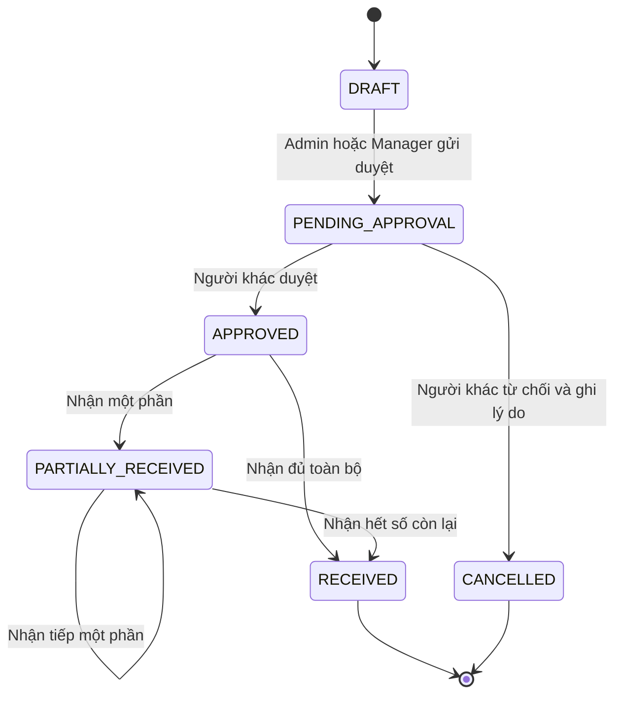
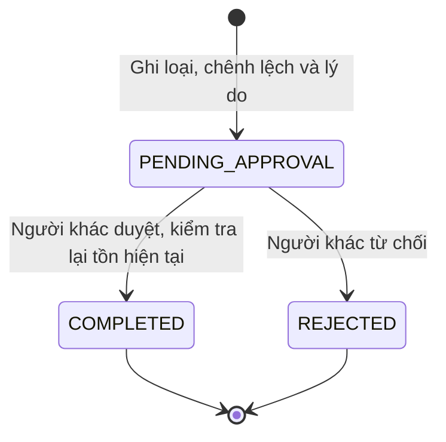

# MOUNTAIN Business Analysis

MOUNTAIN là bài toán quản lý mua hàng và vận hành kho cho một doanh nghiệp phân phối nhỏ. Mục tiêu là theo dõi hàng đã đặt, hàng thực nhận và hàng đang giữ tại từng kho; mọi biến động phải có người thực hiện và có thể đối chiếu. Bối cảnh doanh nghiệp dưới đây là giả định phục vụ portfolio, chưa phải kết quả khảo sát một khách hàng thật.

## Bài toán và phạm vi

Nếu nhân viên quản lý PO và tồn kho trên các bảng tính riêng, một lần nhận hàng có thể được ghi vào PO nhưng bỏ quên sổ kho. Khi có nhiều kho, tổng tồn dương cũng chưa đảm bảo kho xuất có đủ hàng. MOUNTAIN xử lý hai rủi ro này bằng một giao dịch database cho mỗi thao tác nghiệp vụ và kiểm tra tồn tại kho thực hiện.

Phạm vi hiện tại gồm danh mục, sản phẩm, nhà cung cấp, PO có phê duyệt và nhận từng phần, nhập xuất tại kho mặc định, chuyển kho tức thời khi hoàn tất, điều chỉnh có phê duyệt và theo dõi số tiền hóa đơn đã thanh toán. Portal nhà cung cấp và danh mục khách hàng là các chức năng đọc dữ liệu.

Chưa bao gồm đơn bán hàng, giữ chỗ tồn kho, hàng đang vận chuyển, trả hàng, lô và hạn sử dụng, quy đổi đơn vị, định giá tồn kho, VAT, đa tiền tệ hoặc sổ kế toán. Hóa đơn ở đây là theo dõi công nợ đơn giản; chưa có đối chiếu ba bên PO, phiếu nhận và hóa đơn.

## Người dùng và quyền

| Nghiệp vụ | Admin | Manager | Staff | Supplier contact | Customer |
|---|---|---|---|---|---|
| Tạo tài khoản nội bộ | Có | Không | Không | Không | Không |
| Sửa sản phẩm, danh mục, NCC | Có | Có | Chỉ xem | Không | Không |
| Tạo và gửi PO duyệt | Có | Có | Không | Không | Không |
| Duyệt hoặc từ chối PO | Có, khác người tạo | Có, khác người tạo | Không | Không | Không |
| Nhận PO, nhập xuất tay | Có | Có | Có | Không | Không |
| Yêu cầu điều chỉnh | Có | Có | Có | Không | Không |
| Duyệt điều chỉnh | Có, khác người yêu cầu | Có, khác người yêu cầu | Không | Không | Không |
| Thực hiện chuyển kho | Có | Có | Không | Không | Không |
| Hóa đơn, thanh toán | Có | Có | Không | Chỉ hóa đơn của NCC liên kết qua portal | Không |
| Đọc sổ tồn và lịch sử nội bộ | Có | Có | Có | Không | Không |
| Đọc nhật ký người dùng | Có | Không | Không | Không | Không |
| Đọc portal | Theo endpoint | Theo endpoint | Danh mục khách hàng | PO và hóa đơn của NCC liên kết | Danh mục đang hoạt động |

Đăng ký công khai mặc định tắt. Admin đầu tiên được tạo bằng cấu hình bootstrap trên bảng người dùng trống. Các tài khoản tiếp theo do Admin tạo. Gán NCC cho supplier contact hiện cần thao tác quản trị database; chưa có màn hình quản trị liên kết.

## Quy trình mua và nhận hàng

Người nhận chọn PO đã duyệt, nhập số thực nhận cho từng dòng và xác nhận. Hệ thống kiểm tra quyền, trạng thái, dòng thuộc PO và số còn thiếu; sau đó cập nhật số đã nhận, tổng tồn sản phẩm, tồn kho mặc định, lịch sử STOCK_IN và trạng thái PO trong cùng giao dịch. Một dòng lỗi khiến toàn bộ lần nhận bị rollback.

Ví dụ PO đặt 10 đơn vị: nhận 4 đưa PO sang PARTIALLY_RECEIVED và cộng 4 vào kho; nhận tiếp 6 đưa PO sang RECEIVED. Nhận 7 ở lần thứ hai bị từ chối, dữ liệu giữ nguyên.

## Quy tắc nghiệp vụ

| Mã | Quy tắc | Cách áp dụng |
|---|---|---|
| BR-01 | Tổng tồn sản phẩm bằng tổng tồn tất cả kho | Mọi nhập, xuất, nhận PO và điều chỉnh cập nhật hai mức trong cùng transaction; chuyển kho chỉ đổi phân bổ |
| BR-02 | Không có tồn âm hoặc tràn giới hạn số nguyên | Kiểm tra cả tổng tồn và kho mặc định; ràng buộc DB bổ sung trên MySQL |
| BR-03 | Số lượng nhập, xuất, nhận PO, mất, hỏng và chuyển kho là số nguyên dương | Kiểm tra server; không tin riêng form |
| BR-04 | ADJUSTMENT và CORRECTION dùng chênh lệch có dấu, khác 0 | +5 tăng 5; -3 giảm 3; DAMAGED và LOST luôn trừ số lượng dương |
| BR-05 | Yêu cầu chờ duyệt và bị từ chối không thay đổi tồn | Before/after của yêu cầu bằng nhau; giá trị thực tế được ghi khi duyệt |
| BR-06 | Người tạo không duyệt hoặc từ chối chứng từ của mình | Áp dụng PO và điều chỉnh, kể cả Admin |
| BR-07 | Sản phẩm ngừng hoạt động không được dùng cho biến động mới | Chặn nhập, xuất, nhận PO, điều chỉnh và chuyển kho; lịch sử vẫn đọc được |
| BR-08 | PO có ít nhất một dòng, mỗi sản phẩm xuất hiện một lần | Số đặt > 0; đơn giá >= 0, tối đa hai chữ số thập phân; NCC và sản phẩm phải hoạt động |
| BR-09 | Không nhận vượt đặt hoặc nhận vào trạng thái chưa duyệt | 0 < số nhận <= số đặt - số đã nhận; một dòng chỉ xuất hiện một lần trong request |
| BR-10 | Một nghiệp vụ nhiều dòng phải thành công toàn bộ | Tạo PO và nhận PO có transaction bao ngoài |
| BR-11 | Chuyển kho không làm thay đổi tổng tồn | Nguồn khác đích; cả hai hoạt động; kiểm tra lại tồn nguồn khi hoàn tất |
| BR-12 | Yêu cầu chuyển kho chưa giữ chỗ tồn | PENDING chưa trừ tồn; có thể hết hàng trước khi hoàn tất; khi đó trả lỗi và giữ PENDING |
| BR-13 | Bản ghi hoàn tất không bị áp dụng thêm lần nữa | Chặn chuyển trạng thái lặp; optimistic version kiểm soát cập nhật đồng thời |
| BR-14 | Sửa sai bằng bản ghi mới có liên kết | CORRECTION bắt buộc tham chiếu giao dịch COMPLETED cùng sản phẩm; không sửa số lượng gốc |
| BR-15 | Đơn vị sản phẩm và tiền tệ thống nhất | Số lượng nguyên theo unit của sản phẩm; UI dùng USD, hai chữ số thập phân; chưa quy đổi đơn vị hoặc tiền tệ |
| BR-16 | Thanh toán không vượt số còn phải trả | Số trả > 0, tối đa hai chữ số thập phân; 0 <= đã trả <= tổng hóa đơn |
| BR-17 | Hóa đơn cần PO đã duyệt | Cho phép APPROVED, PARTIALLY_RECEIVED hoặc RECEIVED; hạn trả không trước ngày hóa đơn |
| BR-18 | Sản phẩm mới bắt đầu với tồn 0 | Client không được tự gán tồn đầu kỳ; ghi tồn bằng STOCK_IN để có lịch sử |
| BR-19 | Ngừng sản phẩm hoặc kho không làm mất hàng | Sản phẩm phải hết tồn; kho phải hết tồn và không còn chuyển kho PENDING; không tắt kho mặc định |
| BR-20 | Không tự động gửi lại thao tác ghi sau xung đột | HTTP 409 yêu cầu tải lại, kiểm tra kết quả rồi quyết định gửi lại |

BR-01 giả định dữ liệu ban đầu đã đối chiếu. Hệ thống không tự suy đoán hoặc sửa tồn cũ bị lệch. Trước khi chuyển dữ liệu từ hệ thống khác phải đối chiếu bằng truy vấn trong tài liệu audit.

## Điều chỉnh và sửa sai

Nếu lúc yêu cầu tồn là 20 nhưng lúc duyệt tồn là 15, mất 3 đơn vị phải ghi before = 15 và after = 12. Con số lúc yêu cầu không được dùng để ghi đè tồn thực tế lúc duyệt. Hiện sổ giao dịch lưu thời điểm tạo yêu cầu; chưa có trường thời điểm duyệt riêng, vì vậy chưa dùng thời điểm tạo để lập báo cáo số dư lịch sử theo ngày.

## Use case và tiêu chí chấp nhận

| Use case | Điều kiện đầu vào | Kết quả thành công | Ngoại lệ chính |
|---|---|---|---|
| UC-01 Nhận PO | PO đã duyệt, có ít nhất một dòng nhận hợp lệ | Dòng nhận, tổng tồn, tồn kho và sổ STOCK_IN cùng cập nhật | Sai PO, vượt đặt, sản phẩm inactive, xung đột phiên bản: không cập nhật một phần |
| UC-02 Xuất kho | Tài khoản nội bộ, sản phẩm hoạt động, số lượng dương | Trừ kho mặc định và tổng tồn, ghi sổ có người thực hiện | Tổng tồn đủ nhưng kho mặc định thiếu vẫn bị từ chối |
| UC-03 Duyệt điều chỉnh | Manager hoặc Admin khác người tạo, yêu cầu đang chờ | Tính lại từ tồn hiện tại, áp dụng chênh lệch, đánh dấu COMPLETED | Tự duyệt, thiếu tồn hoặc yêu cầu đã xử lý bị chặn |
| UC-04 Hoàn tất chuyển kho | Chuyển kho PENDING, nguồn đủ hàng | Nguồn giảm, đích tăng, tổng tồn giữ nguyên | Đích inactive, nguồn thiếu hoặc đã hoàn tất: không cập nhật |
| UC-05 Thanh toán | Hóa đơn tồn tại, số trả hợp lệ | UNPAID → PARTIAL → PAID theo số đã trả | Vượt số còn lại hoặc số lẻ ngoài độ chính xác bị từ chối |

## Từ điển dữ liệu cốt lõi

Báo cáo NCC tách **orderedValue** (giá trị đã đặt được duyệt) và **receivedValue** (giá trị số thực nhận theo đơn giá PO). Chỉ PO APPROVED, PARTIALLY_RECEIVED và RECEIVED được cộng vào hai chỉ tiêu này; DRAFT, PENDING_APPROVAL và CANCELLED không được cộng. Đây không phải số tiền đã thanh toán; muốn báo cáo paid amount cần nguồn từ hóa đơn và lịch sử thanh toán.

| Dữ liệu | Ý nghĩa | Nguồn ghi |
|---|---|---|
| Product.currentQuantity | Tổng số đơn vị của sản phẩm trên mọi kho | Service nhập xuất và duyệt điều chỉnh |
| WarehouseStock.currentQuantity | Tồn của một cặp warehouse + product duy nhất | Luồng biến động kho và chuyển kho |
| PurchaseOrderItem.quantityOrdered | Số đơn vị đặt | Khi tạo PO |
| PurchaseOrderItem.quantityReceived | Lũy kế thực nhận, không vượt số đặt | Luồng nhận PO |
| InventoryTransaction.quantity | Số lượng nghiệp vụ; có dấu với ADJUSTMENT/CORRECTION | Yêu cầu nghiệp vụ |
| InventoryTransaction.quantityBefore/After | Tổng tồn thực tế trước/sau; bằng nhau khi chưa duyệt | Service khi ghi hoặc duyệt |
| InventoryTransaction.linkedTransaction | Giao dịch gốc của một sửa sai | Chỉ cho CORRECTION |
| version | Phiên bản kỹ thuật chống ghi đè đồng thời | Hibernate, không nhập từ form |
| Invoice.paidAmount | Lũy kế đã trả, không phải từng lần trả | Service thanh toán |

## Quyết định và điểm cần xác nhận

| Quyết định | Lý do trong phạm vi portfolio | Câu hỏi cho doanh nghiệp thực tế |
|---|---|---|
| Nhập xuất tại kho mặc định | Giữ API và form hiện tại nhất quán | Có cần chọn kho cho từng lần nhập xuất không? |
| Chuyển kho một bước khi hoàn tất | Chưa mô hình vận chuyển | Có cần trạng thái đã xuất, đang đi, đã nhận và hao hụt không? |
| Không tự duyệt | Tách trách nhiệm kiểm soát | Có ngoại lệ cho công ty chỉ có một người quản lý không? |
| Từ chối PO đưa về CANCELLED | Khớp mô hình trạng thái đang triển khai | Có cần REJECTED riêng và cho sửa rồi gửi lại không? |
| Optimistic locking | Chặn mất cập nhật và yêu cầu người dùng xem lại dữ liệu | Mức tranh chấp thực tế có cần khóa hàng hoặc hàng đợi không? |
| Giá trị hóa đơn nhập riêng | Phạm vi theo dõi số dư đơn giản | Đối chiếu PO, nhận hàng, chiết khấu và thuế theo cách nào? |

Các yêu cầu tiếp theo, mức ưu tiên và giới hạn hiện tại nằm trong [AUDIT.md](AUDIT.md). Kịch bản nghiệm thu và liên kết với kiểm thử nằm trong [UAT.md](UAT.md).
